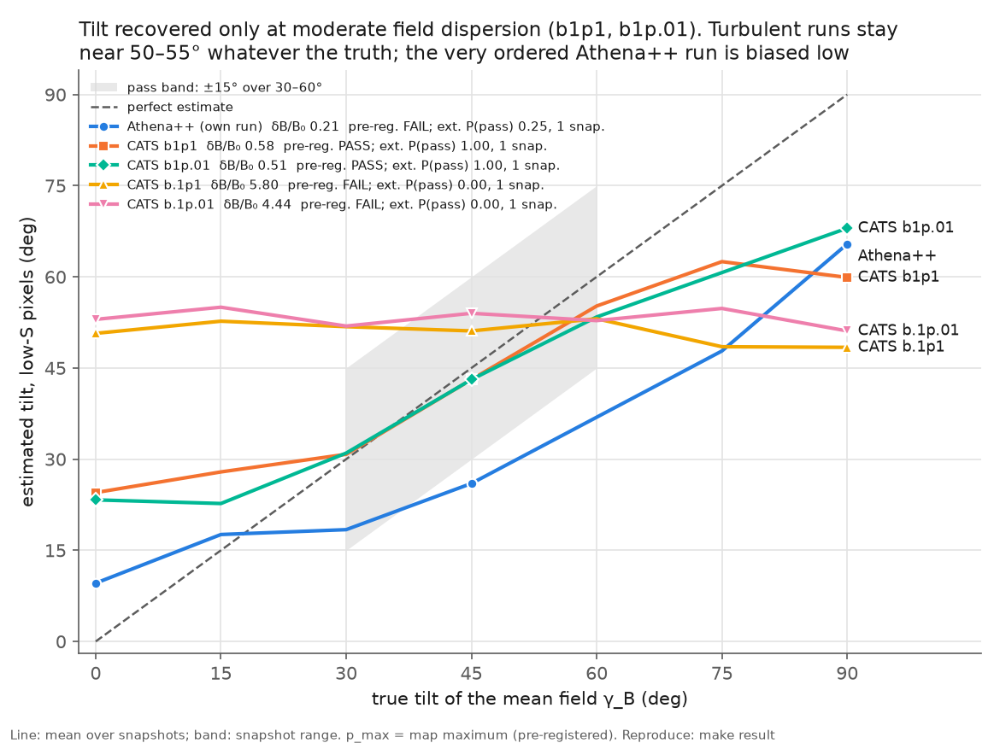

# Setup: cats-tilt MCP server with Claude Desktop

**What you need:** Claude Desktop installed and signed in, Python 3.10 or newer (`python3 --version`), and Git.

## Step 1. Get the code

```bash
cd ~
git clone https://github.com/bhalex86/ai-physics-alexis.git
cd ai-physics-alexis
git checkout week10observability
```

> The last line is needed until the pull request is merged into `main`.

## Step 2. Install the Python packages

```bash
python3 -m venv .venv
source .venv/bin/activate
pip install -r requirements.txt
```

## Step 3. Check it works before involving Claude

```bash
make test
```

Expected last line: `110 passed, 1 skipped`. If this fails, Claude Desktop won't work either, so fix it first.

## Step 4. Make the sample project

```bash
python make_sample_data.py
```

This builds `sample_project/` in about 15 seconds. It contains a small synthetic turbulent cube registered as `sample_run`, a Stokes-map file, and a results database. That's enough to exercise every tool.

## Step 5. Find the three paths Claude Desktop needs

```bash
echo "$PWD/.venv/bin/python"
echo "$PWD/mcp_server_alexis.py"
echo "$PWD/sample_project"
```

Copy the three lines it prints.

## Step 6. Register the server with Claude Desktop

```bash
open -e "$HOME/Library/Application Support/Claude/claude_desktop_config.json"
```

If that says the file doesn't exist, open **Claude Desktop → Settings → Developer → Edit Config**, which creates it. Put in the following, replacing the three paths with yours from step 5:

```json
{
  "mcpServers": {
    "cats-tilt": {
      "command": "/Users/YOU/ai-physics-alexis/.venv/bin/python",
      "args": ["/Users/YOU/ai-physics-alexis/mcp_server_alexis.py"],
      "env": {"CATS_PROJECT_DIR": "/Users/YOU/ai-physics-alexis/sample_project"}
    }
  }
}
```

If the file already lists other servers, add the `"cats-tilt": {...}` block inside the existing `"mcpServers"`, separated from the others by a comma. Save the file.

## Step 7. Restart Claude Desktop

Quit it completely with **Cmd+Q**. Closing the window isn't enough. Then reopen it. In a new chat, open the tools menu (the slider icon in the message box). **cats-tilt** should be listed with 13 tools.

## Step 8. Try it

Ask each of these in a new chat:

1. *"List the runs available in cats-tilt."*
   You should get `sample_run`, with stored results at 0–90°.
2. *"Estimate the tilt of sample_run viewed at 45°, with its uncertainty and field regime. Give the verification ID."*
   You should get a number, a `V-…` verification ID, and the regime note.
3. *"Look up the stored result for sample_run at 120 degrees."*
   This is an error case. It should come back `INVALID_INPUT`, and Claude should say so rather than invent a value.
4. *"Show me the code that turns p into the tilt."*
   Claude should call `read_source` and quote Chen eq. 10.

## Step 9. Check what Claude reported

Go back to Terminal, in the repo folder with the venv active:

```bash
export CATS_PROJECT_DIR="$PWD/sample_project"
python verify.py --list
python verify.py V-xxxx-001-xxxxxxxxxxxx --expect tilt_deg_low_S=<number Claude gave>
python trace_alexis.py sample_project/logs/mcp_server_alexis.jsonl --run last --args
```
# cats-tilt: an MCP server for magnetic-field tilt from dust polarization
This along with most of the code was generated using Claude Opus 5.5 . Please note that the data files were used from a local folder
`mcp_server_alexis.py` lets an LLM client such as Claude Desktop estimate how far a cloud's magnetic field is tilted out of the plane of the sky. It uses the dust-polarization method of Chen et al. (2019, MNRAS 485, 3499) on public MHD simulations from the CATS archive (Burkhart et al. 2020, ApJ 905, 14).

The server does the physics; the LLM calls the tools, can read the code behind them, and reports what they return. Every reply carries a **verification ID** that you can check independently with `verify.py`.

Part of the PHYS 7440 project *Testing a dust-polarization estimator of magnetic-field inclination in public MHD simulations* (B. Alexis). The design is in `design_alexis.md`.


## For reviewers (start here)

Branch `week10observability`. Each peer-review question, and where it is answered:

| Question | Where to look | One command |
|---|---|---|
| 1. Can I reproduce the main result from the README alone? | [Key result](#key-result-hw10) below: figure, table and the run's log in `results/` | `pip install -r requirements.txt && make result`, then `make check-reproducible` (compares with the committed files) |
| 2. Are random seeds and API keys handled correctly? | [`REPRODUCIBILITY.md`](REPRODUCIBILITY.md) lists every source of randomness; keys are in `.env` / `~/.cats_mcp_key`, git-ignored, and never logged (redacted in the JSON logs, tested in `test_observability_alexis.py`) | `make test` (110 offline tests) |
| 3. Is every quantitative claim traceable to a specific output? | Result numbers come from `results/tilt_recovery_grades_alexis.md` (made from `cache/pipeline_cache_alexis.db`, whose hash `--verify` checks). Numbers in the review documents carry a section label in [`results/review_checks_alexis.txt`](results/review_checks_alexis.txt). Every MCP answer carries a signed verification ID (`verify.py`). | `make review-checks`, `python data_pipeline_alexis.py --verify` |
| 4. Is AI tool use documented? | [`AI_USE.md`](AI_USE.md) | none |

Also: [`BUG_LOG.md`](BUG_LOG.md) (bugs found and fixed), [`PHYSICS_REVIEW_alexis.md`](PHYSICS_REVIEW_alexis.md) (the physics checked against Chen et al. 2019), and `python trace_alexis.py <log>` (rebuilds the call tree of any run from its JSON log). Known open item: the CATS numbers still come from the pre-HW10 method until `make rebuild` is run where the data are (see the note under Key result).

---

## Key result (HW10)



**Pre-registered analysis** (the proposal's seven viewing angles, one snapshot per run): **the Chen et al. (2019) estimator recovers the field tilt in both ordered-field CATS runs (b1p1, b1p.01: median |error| 1.9°, slope 0.75–0.81, PASS).** In the two turbulence-dominated runs (δB/B₀ = 4.4 and 5.8), it returns 48–55° whatever the true tilt (slope ≈ 0.04, FAIL). My 64³ Athena++ run fails in the other direction: its field is so ordered (δB/B₀ = 0.21) that no sightline lies near the plane of the sky. p_max then underestimates p₀, and the tilt comes out 19° too low at 45°. With the true p₀ the same maps give 43°. So the method works in a window of moderate dispersion, not simply "whenever the field is ordered" (`PHYSICS_REVIEW_alexis.md`, finding 1). Low-S estimator, p_max = map maximum (the pre-registered rule), graded by `evaluate.py` over true tilts of 30–60°. The full table is in [`results/tilt_recovery_grades_alexis.md`](results/tilt_recovery_grades_alexis.md).

> **Pending rebuild.** The method changed in the HW10 review: cubic sampling of B, a KDE on every pixel, 5° tilts, three snapshots per CATS run, and bootstrap intervals. The figure and table above are graded and drawn by the new code, but from the **old-method cache** (7 tilts, one snapshot per run). The CATS archive was not reachable where the change was made. To recompute everything: `make rebuild` (= `python rebuild_alexis.py --plant-failures`, see `PHYSICS_REVIEW_alexis.md`). On the Athena++ run, the only one rebuilt so far, the estimates moved by at most 0.1°.

**Reproduce it from a fresh clone with one command** (about 5 s; no data download):

```bash
git clone https://github.com/bhalex86/ai-physics-alexis.git && cd ai-physics-alexis
git checkout week10observability
python3 -m venv .venv && source .venv/bin/activate && pip install -r requirements.txt
make result
```

`make result` runs two steps. First, `python data_pipeline_alexis.py --verify` checks the committed cache against the hash in `provenance_alexis.json`, and fails if the cache was edited. Second, `python make_key_result_alexis.py` grades every run and writes:

| File | Content |
|---|---|
| `results/tilt_recovery_alexis.png` | the figure above |
| `results/tilt_recovery_grades_alexis.csv` / `.md` | grade per run × estimator × p_max rule |
| `results/tilt_recovery_points_alexis.csv` | every plotted point |
| `results/key_result_run_alexis.jsonl` | **the JSON log of the run that produced the committed files** |

`make check-reproducible` runs it twice and compares the two runs, and then compares the outputs with the versions committed in git (tables byte for byte, the figure pixel by pixel). `make trace` prints the call tree of the committed run from its log. The cache itself comes from `make pipeline` (`data_pipeline_alexis.py --fetch --build --verify --all`), which downloads about 1 GB from CATS.

## Observability and reproducibility (HW10)

**Every tool call writes one JSON line**, using `python-json-logger` through one shared module, `obs_logging_alexis.py`. Each line has: `timestamp` (ISO-8601 UTC), `tool`, `input_args` (API keys and tokens redacted, arrays summarised as shape + dtype, local paths made relative), `output_summary` (a structured summary) and `output_preview` (its first 200 characters), `elapsed_ms`, `status` (`success` / `failure`), and `error_type` / `error_message`. `run_id`, `seq`, `parent_seq` and `depth` rebuild the call tree. Each run also logs a `run_start` line (command, seeds, package versions, git commit) and a `run_end` line (number of calls and failures).

| Component | What counts as a tool call | Log file |
|---|---|---|
| `data_pipeline_alexis.py` | every HTTP attempt and download attempt, the GitHub API call, reading CATS / Athena++ files, the cube checks, normalisation, each `rotate_maps.rotated_maps` and `firstmap_b.estimate_from_maps` call (per angle and p_max rule), cache writing, hashing, CSV export, and each command. Retries and missing fields go into the same log, under the call they happened in. | `logs/pipeline_alexis.jsonl` |
| `mcp_server_alexis.py` | every MCP tool (all 13), with its `verification_id` and error code, so each line matches its entry in the signed `audit_log.jsonl` | `logs/mcp_server_alexis.jsonl` (`CATS_TOOL_LOG`) |
| `hw8/eval_harness.py` | every `anthropic.messages.create` request (model, temperature, the reply's text and tool calls, token use) and every MCP tool call the harness makes; the scored result of each item. The server it starts logs to its own file, linked by `parent_run_id`. | `logs/eval_harness_alexis.jsonl` |
| `hw8/make_ground_truth.py` | loading the cubes and each estimator call | `logs/make_ground_truth_alexis.jsonl` |
| `make_key_result_alexis.py` | reading the cache, grading, writing the tables and the figure | `results/key_result_run_alexis.jsonl` (via `make result`) |

Every script takes `--log-file`, or the environment variable `OBS_LOG_FILE`. Logs under `logs/` stay on each machine (`.gitignore`); only the log of the committed result is in the repository. To read a log: `python trace_alexis.py <log> [--args] [--failures]`. `hw8/score_desktop.py` makes no tool calls of its own: Claude Desktop calls the MCP server, which logs them.

**Seeds and randomness:** [`REPRODUCIBILITY.md`](REPRODUCIBILITY.md). Every entry point runs `random.seed(42)` and `numpy.random.seed(42)` first, LLM calls use `temperature=0`, and the file lists every other source of randomness and how it is controlled. **Bugs found and fixed:** [`BUG_LOG.md`](BUG_LOG.md). **Physics review** (every equation checked against Chen et al. 2019, plus measured systematics): [`PHYSICS_REVIEW_alexis.md`](PHYSICS_REVIEW_alexis.md). **Tests:** `make test` (all offline). New in HW10: `test_observability_alexis.py`, which covers the log fields, key redaction, the call tree, an identical pipeline rerun, and the LLM harness with a fake client at temperature 0.

---

## 1. Quick start from scratch

No data download needed. About two minutes:

```bash
git clone <this repository's URL> && cd <repository folder>
python3 -m venv .venv && source .venv/bin/activate
pip install -r requirements.txt
python make_sample_data.py                     # writes sample_project/ (4 MB, ~5 s)
pytest test_mcp_server_alexis.py -v            # 31 passed, 1 skipped
CATS_PROJECT_DIR=sample_project python mcp_server_alexis.py   # starts; waits for a client on stdio
```

`make_sample_data.py` builds a small **synthetic** 64³ cube (fixed random seed, mean field along x), a Stokes-map file, a `runs.json` registering the cube as `sample_run`, and a `results.db` of stored results. That is enough to exercise every tool. Its numbers test the software, not the physics: the sample run's grade comes out FAIL, which is expected for this toy cube.

The skipped test calls the real CATS archive over the internet; enable it with `CATS_LIVE=1`.

This sequence was checked in a fresh virtual environment containing only the server files listed in section 2.

## 2. Requirements and files

**Python** 3.10 or newer (tested with 3.10, 3.13 and 3.14). Dependencies are in `requirements.txt`:

- `mcp` 2.x: the server uses the 2.x `MCPServer` API, which differs from mcp 1.x
- `numpy`, `scipy`, `astropy`, `pandas`
- `certifi`: needed on macOS with python.org Python to verify HTTPS certificates
- `pytest`, `jsonschema`: for the tests
- `python-json-logger`: the JSON tool-call log (HW10)

**All of these files must be in one folder:**

| File | Role |
|---|---|
| `mcp_server_alexis.py` | the MCP server |
| `firstmap_b.py` | Stokes maps and Chen's estimator (eqs. 1–3, 9, 10) |
| `rotate_maps.py` | tilted viewing angles |
| `evaluate.py` | grading of stored results |
| `prepare_arepo.py` | field-component check (∇·B = 0) |
| `build_db.py` | builds `results.db` from result CSVs |
| `make_sample_data.py` | builds the from-scratch sample project |
| `verify.py` | checks verification IDs |
| `obs_logging_alexis.py` | JSON tool-call log and seeds (HW10) |
| `test_mcp_server_alexis.py` | tests |
| `requirements.txt` | dependencies |
| `design_alexis.md` | design document |

> **The server is not a single self-contained file.** `mcp_server_alexis.py` imports `firstmap_b.py`, `rotate_maps.py`, `evaluate.py`, `prepare_arepo.py` and (since HW10) `obs_logging_alexis.py`. Without them in the same folder it stops at startup with `ModuleNotFoundError`.

### What is in this repository, and what is not

Besides the server files above, the repository holds the rest of the analysis pipeline and its results, so the project's numbers can be reproduced as well as the server:

| File | Role |
|---|---|
| `measure_turbulence.py` | measures δB/B₀, Mach numbers and density statistics of each run |
| `check_arepo.py` | checks AREPO field labels and the 512³ → 256³ averaging |
| `sensitivity.py` | how much the p_max rule and peak method change the estimates |
| `monte_carlo.py` | reproduces the Monte Carlo test of Chen et al. (2019), Table 1 |
| `test_evaluate.py` | tests of the grading criteria |
| `make_comparison_pdf.py` | builds the one-page comparison with Chen et al. |
| `.gitignore` | keeps the files below out of the repository |

> **Not yet in the repository (HW10 review):** earlier versions of this table listed `stageAB_results.csv`, `stageAB_grades.csv`, `turbulence.csv` and `runs.json` as committed, but none of them is on any branch. Without them, `build_db.py --results stageAB_results.csv` cannot run from a clone, and the stored-result tools have no data for the six project runs. Until they are committed, use the pipeline's export for the five runs it covers: `python build_db.py --results cache/results_rotated.csv`. That export has no AREPO runs and no `turbulence.csv`. Regenerate `turbulence.csv` with the corrected `measure_turbulence.py`, because its `M_A` changed (`PHYSICS_REVIEW_alexis.md`, finding 2).

Some files are deliberately **not** committed. Each is either downloadable, generated, or private:

| Not in the repository | Why | How to get it |
|---|---|---|
| FITS and HDF5 simulation data (`b1p1/`, `arepo_B30/`, …) | gigabytes | download from the CATS archive (section 9) |
| `results.db` | generated | `python build_db.py --results stageAB_results.csv`, or `python make_sample_data.py` for the sample |
| `sample_project/` | generated | `python make_sample_data.py` |
| `audit_log.jsonl` | local: contains paths from the author's computer | created on each machine by the server |
| `planted_failures.json` | the answer key for scoring the LLM | kept private by the author |
| `.env`, `~/.cats_mcp_key` | secrets (an API key, the signing key) | each user's own; the key is created on first run |

**Checking reproducibility:** clone the repository into an empty folder and follow section 1. If the tests pass there, the code runs without anything from the author's computer.

**Peer review** (Weeks 10 and 12) happens as pull requests on this repository.

## 3. Running the server

**On its own:** `python mcp_server_alexis.py` starts it on stdio. It prints nothing and waits for an MCP client.

**In Claude Desktop:** add this to `~/Library/Application Support/Claude/claude_desktop_config.json`, then quit and reopen Claude Desktop:

```json
{
  "mcpServers": {
    "cats-tilt": {
      "command": "/full/path/to/python3",
      "args": ["/full/path/to/mcp_server_alexis.py"],
      "env": {"CATS_PROJECT_DIR": "/full/path/to/sample_project"}
    }
  }
}
```

- **`command`:** the Python the requirements are installed in (`which python3` inside the virtual environment).
- **`env`:** drop this line to use your own data instead of the sample; the server then uses the folder it sits in.

## 4. Environment variables

All are optional.

| Variable | Default | Purpose |
|---|---|---|
| `CATS_PROJECT_DIR` | folder of `mcp_server_alexis.py` | where `runs.json`, `results.db` and relative FITS paths are looked up |
| `CATS_ALLOWED_DIRS` | (none) | extra folders FITS files may be read from, separated by `:` |
| `CATS_KEY_FILE` | `~/.cats_mcp_key` | secret signing key; created on first run with permissions 600 |
| `CATS_AUDIT_LOG` | `<project folder>/audit_log.jsonl` | signed log of every tool call |
| `CATS_BASE_URL` | `https://users.flatironinstitute.org/~bburkhart/data/CATS/` | CATS archive root |
| `CATS_HTTP_TIMEOUT` | `20` | seconds per CATS request |
| `CATS_HTTP_RETRY_DELAY` | `1` | seconds before the one retry |
| `CATS_LIVE` | (unset) | tests only: `1` runs the live CATS test |

No API keys or credentials are needed: the CATS archive is public.

## 5. Tools

The two core endpoints are `cats_catalog` (external API) and `estimate_tilt_from_cubes` (dataset).

| Tool | Inputs | What it returns | Source |
|---|---|---|---|
| **`cats_catalog`** | `folder` | sub-folders and files in one CATS folder | CATS archive over HTTPS |
| **`estimate_tilt_from_cubes`** | `density`, `bx`, `by`, `bz`, `line_of_sight`, `angle`, `pmax_percentile` | tilt estimate, true tilt, field regime, uncertainty, comparison with Chen | FITS cubes (+ `results.db`) |
| `estimate_tilt_from_stokes` | `stokes_i`, `stokes_q`, `stokes_u`, `pmax_percentile` | tilt estimate and uncertainty from 2-D maps | FITS maps (+ `results.db`) |
| `inspect_fits` | `path` | HDUs, shapes, header keywords, SHA-256 | FITS file |
| `read_source` | `name` | the code and docstring of a physics function, and the Chen equation it implements | the project's modules |
| `list_runs` | none | approved runs, whether their files exist, what is stored | `runs.json`, `results.db` |
| `run_properties` | `run_id` | stored turbulence measurements (δB/B₀, M_s, M_A) | `results.db` |
| `load_cube` | `run_id` | summary of a run's cubes | FITS cubes |
| `make_map` | `run_id`, `angle` | summary of one synthetic map, and its `map_id` | FITS cubes |
| `estimate_tilt` | `map_id`, `pmax_percentile` | estimate for that map | FITS cubes |
| `lookup_result` | `run_id`, `angle`, `pmax_rule` | one stored result | `results.db` |
| `grade_run` | `run_id`, `pmax_rule` | grade: median \|error\| and slope over 30–60° | `results.db` |
| `get_call_log` | `last_n` | this session's calls, in order, with verification IDs | audit log |

Every input is described in the tool's published JSON Schema, with its range or allowed values: for example `angle` is 0–90, `line_of_sight` one of `z`, `y`, `x`, `tilted`, and `pmax_percentile` 90–100. The full schemas of the two core tools are in `design_alexis.md`.

**Key conventions**
- **Tilt γ:** 0° means the field lies in the plane of the sky; 90° means it points along the line of sight.
- **`line_of_sight`:** `z`, `y` or `x` views the cube straight down that axis, as stored (the default is `z`). `tilted` builds a view with the mean field tilted by `angle`.
- **`pmax_percentile`:** 100 (the default) takes p_max as the map maximum, as in Chen et al. and this project's pre-registered rule. 99.5 uses the 99.5th percentile.
- **FITS paths:** absolute, or relative to the project folder. Only files inside the project folder (or `CATS_ALLOWED_DIRS`) can be read, and names must end in `.fits` or `.fits.gz`.

## 6. Example tool calls and expected outputs

Verification IDs and timestamps differ on every run; the other values are what you should see.

**`list_runs`** (sample project), with `{}`:
```json
{"verification_id": "V-c544-…", "call_number": 1,
 "runs": [{"run_id": "sample_run", "code": "synthetic", "gravity": false, "snapshot": "seed 0",
           "description": "synthetic 64^3 turbulent cube, mean field along x (not a CATS simulation)",
           "cube_files_present": true,
           "stored_results": {"max": [0.0, 5.0, 10.0, "...", 85.0, 90.0],
                              "p99.5": [0.0, 5.0, 10.0, "...", 85.0, 90.0]}}]}
```

**`lookup_result`** (sample project), with `{"run_id": "sample_run", "angle": 45}`:
```json
{"verification_id": "V-c544-…", "call_number": 2, "source": "db:results:4",
 "run": "sample_run", "rule": "max", "angle": 45, "gamma_B_true": 45.0,
 "gamma_obs": 40.2, "gamma_obs_lowS": 41.8, "err": -4.8, "err_lowS": -3.2, "...": "..."}
```

**`estimate_tilt_from_cubes`** on real CATS data: Cho-ENO run `b.1p.01`, snapshot `t_750` (download in section 9), with `{"density": "b.1p.01/dens_t750.fits", "bx": "b.1p.01/magx_t750.fits.gz", "by": "b.1p.01/magy_t750.fits.gz", "bz": "b.1p.01/magz_t750.fits.gz", "line_of_sight": "tilted", "angle": 45}`. Takes about 15 s. Shortened output:
```json
{"verification_id": "V-443a-001-9663808f53c1", "call_number": 1,
 "tilt_deg_low_S": 54.0, "tilt_deg_all_pixels": 57.3, "true_tilt_deg": 45.0,
 "uncertainty_deg_low_S": 6.1,
 "view": {"line_of_sight": "tilted", "angle_deg": 45.0, "tilted_toward_axis": "z"},
 "pmax_percentile": 100.0,
 "field_regime": {"dB_over_B0": 4.438, "ordered_field_dominates": false,
                  "note": "the turbulent field is 4.4 times the mean field: ... treat this estimate as unreliable"},
 "uncertainty": {"low_S": {"components_deg": {"pmax_rule_sensitivity": 5.1,
                                              "estimator_spread_all_vs_lowS": 3.3,
                                              "project_calibration_median_abs_err": null}, "...": "..."},
                 "comparison_with_chen_2019": {"citation": "Chen C.-Y. et al. 2019, MNRAS 485, 3499",
                     "nearest_tabulated_tilt_deg": 60.0,
                     "error_at_that_tilt_deg": {"L1 (least turbulent)": -3.6, "L10": -6.5,
                                                "L20 (most turbulent)": -9.5}, "...": "..."},
                 "caveats": ["the turbulent field is 4.4 times the mean field: ...", "..."]},
 "warnings": ["the turbulent field is 4.4 times the mean field: ... treat this estimate as unreliable"]}
```
This run is turbulence-dominated, the regime where the method fails, and the reply says so. `project_calibration_median_abs_err` is `null` here because no `results.db` was present.

The top-level `tilt_deg_*`, `true_tilt_deg` and `uncertainty_deg_low_S` fields duplicate the nested values for clients that read a single key. The course's `eval_harness.py --mode tool` was run against this server this way and scored it correctly.

**`cats_catalog`**, with `{"folder": "MHD/256/b1p1/"}`. This needs internet; the folders shown are what the real archive lists for this run:
```json
{"verification_id": "V-…", "call_number": 3,
 "url": "https://users.flatironinstitute.org/~bburkhart/data/CATS/MHD/256/b1p1/",
 "folders": ["t_500/", "t_550/", "t_600/", "t_650/", "t_700/", "t_750/", "t_800/", "t_850/", "t_900/"],
 "files": [], "n_entries": 9, "retrieved_at": "2026-10-29T13:20:04-0500"}
```

**`read_source`**, with `{"name": "firstmap_b.gamma_from_p"}`:
```json
{"verification_id": "V-…", "name": "firstmap_b.gamma_from_p", "signature": "gamma_from_p(p, p0)",
 "implements": "Chen eq. 10 (tilt gamma from p and p0)", "first_line": 108, "last_line": 112,
 "file": {"path": ".../firstmap_b.py", "size_bytes": 9903, "sha256": "…"},
 "source": "def gamma_from_p(p, p0):\n    \"\"\"Chen eq. 10, clipped to the physical range.\"\"\"\n    cos2 = p * (1 + 2 * p0 / 3) / (p0 * (1 + p))\n    ..."}
```
With `{}` it returns an index of every readable function and the Chen equation each implements. Only the five project modules can be read.

**`get_call_log`**, with `{}`:
```json
{"verification_id": "V-…", "session": "c544",
 "calls": [{"call_number": 1, "tool": "list_runs", "verification_id": "V-c544-001-…", "ok": true},
           {"call_number": 2, "tool": "lookup_result", "verification_id": "V-c544-002-…", "ok": true}]}
```

## 7. Errors

**Missing or wrongly typed arguments** are rejected by the MCP SDK against the tool's schema before the tool runs. The reply has `is_error: true` and names the field. For example, `lookup_result` with `{"run_id": "sample_run"}` gives "angle: Field required".

**Every other failure** has `is_error: true` and a JSON body:
```json
{"error": {"code": "NO_DATA",
           "message": "no stored result for run 'sample_run', angle 20, rule 'max'; stored angles: [0, 15, 30, 45, 60, 75, 90]",
           "tool": "lookup_result", "verification_id": "V-c544-003-a90983383806"}}
```

| Code | Meaning |
|---|---|
| `INVALID_INPUT` | right type, invalid value (e.g. `angle` 120, a 2-D file where a cube is needed) |
| `UNKNOWN_RUN` | `run_id` is not in `runs.json` |
| `PATH_NOT_ALLOWED` | a file is outside the allowed folders |
| `FILE_NOT_FOUND` | a named file, or a run's cube file, does not exist |
| `NO_DATA` | valid request, but nothing is stored for it |
| `NOT_FOUND` | the CATS archive has no such folder (HTTP 404) |
| `TIMEOUT` | the CATS archive did not answer in time, after one retry |
| `NETWORK_ERROR` | the CATS archive could not be reached (DNS, connection, certificates) |
| `UPSTREAM_ERROR` | the CATS archive returned another HTTP error |
| `SERVER_NOT_CONFIGURED` | `runs.json` or `results.db` is missing |
| `UNKNOWN_NAME` | `read_source` was asked for a module or function it does not expose |
| `INTERNAL_ERROR` | an unexpected exception, reported instead of crashing |

Failed calls are signed and logged like successful ones.

## 8. Verifying what the LLM reported

Every call is signed with HMAC-SHA256 using a secret key on your computer (`~/.cats_mcp_key`), which the LLM never sees, and appended to `audit_log.jsonl`. So the LLM cannot invent a valid ID, and an edited log entry fails the check.

```bash
python verify.py --list                                       # this session's calls, in order
python verify.py V-443a-001-9663808f53c1 --files --expect tilt_deg_low_S=54.0
```

| Result | Meaning |
|---|---|
| `VALID` | the call happened and its log entry is unaltered |
| `INVALID` | the entry was edited, or signed with a different key |
| `NOT FOUND` | no tool call produced this ID, e.g. the LLM made it up |
| `unchanged` / `CHANGED since` (with `--files`) | whether the input files are the ones used, by SHA-256 |
| `MATCH` / `MISMATCH` (with `--expect`) | whether a number the LLM quoted is what the tool returned; add `--tol 0.51` if it rounded to whole degrees |

## 9. Using the real CATS data

Download a run's four files into the project folder, for example Cho-ENO `b1p1` at snapshot `t_900`:

```bash
mkdir -p b1p1 && for f in dens magx magy magz; do
  curl -C - -o b1p1/${f}_t900.fits.gz \
    https://users.flatironinstitute.org/~bburkhart/data/CATS/MHD/256/b1p1/t_900/${f}_t900.fits.gz
done
```

- **Find what exists:** `cats_catalog` lists runs and snapshots. Some folders store density uncompressed (`dens_t750.fits`).
- **Estimate the tilt:** pass the four files to `estimate_tilt_from_cubes`. Each is about 60 MB; a call takes 15–20 s and about 1 GB of memory.
- **AREPO runs:** these come as 512³ HDF5 files. Convert them to 256³ FITS first with `prepare_arepo.py`.
- **Stored-result tools:** add the runs to `runs.json`, run `rotate_maps.py` on them, then `python build_db.py`.

**Data citations requested by CATS:**
- Cho & Lazarian 2003, MNRAS 345, 325
- Burkhart et al. 2009, ApJ 693, 250
- Burkhart et al. 2020, ApJ 905, 14
- Mocz et al. 2017, ApJ 838, 40 (AREPO runs)

## 10. Tests

```bash
pytest test_mcp_server_alexis.py -v                      # 31 passed, 1 skipped, ~5 s
CATS_LIVE=1 pytest test_mcp_server_alexis.py -k live     # also call the real CATS archive
```

The tests run on a small fake project in a temporary folder, with a temporary key and audit log, so your real files are never touched.

- **Valid inputs:** every tool, with each output checked against an expected JSON Schema.
- **Invalid inputs:** every tool, each required to return a structured error with the right code.
- **Network failures, simulated:** a timeout (retried once, then reported), HTTP 404, and no connection.
- **Planted failures:** a missing run, an impossible stored value (flagged, not hidden), and a question with no stored answer.
- **Physics checks:** the default and tilted views give the right true tilt, and a turbulence-dominated cube is flagged as unreliable.
- **Verification:** genuine IDs pass, forged IDs and edited log entries fail.

## 11. Live demo (Meeting 2)

1. Run `pytest test_mcp_server_alexis.py -q` and show 31 passed.
2. In Claude Desktop, show that the `cats-tilt` tools are listed.
3. A successful call: *"List the snapshots of CATS run b1p1, then estimate the tilt of the b1p1 t_900 cubes viewed at 45°, with its uncertainty compared to Chen. Show me the code that turns p into the tilt, and list the tools you used, in order."*
4. An error case: *"Look up the stored result for sample_run at 120 degrees."* It returns `INVALID_INPUT`.
5. In Terminal: `python verify.py --list`, then `python verify.py <id> --expect tilt_deg_low_S=<value>` on a number from Claude's answer.

## 12. Known failure modes

- **Turbulence-dominated fields.** When the turbulent field outweighs the mean field, the estimate stays near 45–58° whatever the true tilt. For cubes the server measures δB/B₀ and warns above 1. This project's runs passed at δB/B₀ = 0.51–0.64 and failed at 4.4–5.8; values in between are untested. Very ordered fields fail in the other direction (next item). For Stokes maps δB/B₀ is unknown, so only estimates in the failing range are flagged.
- **Very ordered fields (tilt underestimated).** When δB/B₀ is small, no sightline lies near the plane of the sky. p_max then falls below p₀/(1 − p₀/3), the derived p₀ is too small, and the tilt comes out too **low**, by more at larger tilts. In this project: AREPO B100 (δB/B₀ = 0.12) gave −6/−9/−14° at 30/45/60° and only just passes; my Athena++ run (0.21) gave −12/−19/−23° and fails. The derived p₀ can never exceed the true p₀, so here the estimate is roughly a lower bound. For cubes the server reports `reliability: "biased_low"` below δB/B₀ = 0.35 (0.21–0.51 is untested). The polarization-angle dispersion S overlaps between these runs and the passing ones, so for Stokes maps this regime cannot be flagged. See `PHYSICS_REVIEW_alexis.md`, finding 1.
- **Idealized maps.** They assume optically thin emission and uniform grain alignment, with no noise or telescope beam. `estimate_tilt_from_stokes` does not de-bias noisy observations.
- **Mislabelled field files** give a wrong tilt. The ∇·B check runs on every cube; the anisotropy check runs only when the ordered field dominates. A warning is added if either fails.
- **File names.** Names must end in `.fits` or `.fits.gz`. Some uploads rename `magx_t750.fits.gz` to `magx_t750_fits.gz`, which is rejected; rename it back.
- **Network.** The CATS archive may be slow or unreachable, giving `TIMEOUT` or `NETWORK_ERROR` after one retry. On macOS, missing certificates also show as `NETWORK_ERROR`; `pip install certifi` fixes it.
- **Speed and memory.** A 256³ cube takes 15–20 s and about 1 GB. Larger cubes should be block-averaged first.
- **Stored-result tools** need `runs.json` and `results.db`; without them they return `SERVER_NOT_CONFIGURED`. The cube and Stokes tools still work, without the calibration part of the uncertainty.
- **Verification is local.** It proves the server produced a value, not that the physics is right, and anyone who can read `~/.cats_mcp_key` can forge IDs. Don't give the LLM file access to your home folder.
## HW9: data ingestion pipeline (`data_pipeline_alexis.py`)

The pipeline is the offline stage that feeds the read-only MCP server: it gets the data, normalises it, runs the
Chen et al. (2019) estimator at seven viewing angles with the existing `firstmap_b.py` / `rotate_maps.py`, and stores the
results in a SQLite cache. The MCP server itself is unchanged.

### The two sources

| | Source 1: CATS Cho-ENO | Source 2: Athena++ (my own run) |
|---|---|---|
| What | `dens`, `magx`, `magy`, `magz` FITS cubes, run `b.1p.01`, snapshot 750 (`--all` adds `b1p1_t900`, `b1p.01_t900`, `b.1p1_t900`) | one `.athdf` snapshot (64³, isothermal MHD, uniform B₀ along x, M_A ≈ 0.4) |
| How | HTTPS download from `users.flatironinstitute.org/~bburkhart/data/CATS/MHD/256/<run>/t_<snap>/` | built at the pinned commit `1395e2f543f4368d448cb1a2cf92ba1f910e3416` and run serially with a fixed seed; the pipeline reads the `.athdf` and calls the GitHub API for the commit record |
| Version | no version number exists; the SHA-256 of each file is the version | commit SHA + SHA-256 of the `.athdf` |
| Citations | Burkhart et al. 2020; Cho & Lazarian 2003; Burkhart et al. 2009; Portillo et al. 2018; Bialy & Burkhart 2020 | Stone et al. 2020 |

(CATS also lists an "Athena++" entry; it is a set of driven mixing-layer simulations and is **not** used here.)

### Run it from a fresh clone

```bash
git clone https://github.com/bhalex86/ai-physics-alexis.git && cd ai-physics-alexis
python3 -m venv .venv && source .venv/bin/activate
pip install -r requirements.txt
# optional: a GitHub token raises the API limit from 60 to 5000 requests/hour
echo "GITHUB_TOKEN=your_token_here" > .env

python data_pipeline_alexis.py --fetch --build --verify --all
```

`--all` matters: the committed `provenance_alexis.json` records the cache hash for all four CATS runs plus the Athena++ run,
and `--build` checks its new hash against that record (`reproduces_previous_build` in the provenance file, and a
`REPRODUCED` / `NOT REPRODUCED` line from `--verify`). With a different run set the two hashes are not comparable and the check
is skipped. The committed hash `8f9c8db5…` was reproduced exactly on a second machine (Linux, Python 3.10, NumPy 2.2) from
the same raw files.

* `--fetch` downloads the CATS files (about 240 MB per run) and the GitHub commit JSON. Files already on disk are reused.
  Put previously downloaded CATS files in `<project>/b.1p.01/` (the layout `rotate_maps.py` uses), or point `--project` at that folder.
  To record a genuine access time for them, run once with `--force` to download them again.
* `--build` normalises, estimates, writes `cache/pipeline_cache_alexis.db` and updates `provenance_alexis.json`.
* `--verify` recomputes the cache hash and compares it with the hash in `provenance_alexis.json` (and, right after a `--build`, reports whether the build reproduced the hash recorded before it), and re-hashes every raw file.
  It exits 0 if everything matches and 1 otherwise.

Choose the source with `--source cats` (download from the CATS site only), `--source athena` (my Athena++ run only) or `--source both` (default).
Other options: `--all` (all four CATS runs), `--runs b.1p.01_t750`, `--no-github` (offline), `--force` (download again), `--project DIR`,
`--athena-file PATH`, `--help`.
Always pass the same run set to `--build` and `--verify`: each build rewrites the cache from scratch for the runs you ask for.

### The Athena++ box (or skip it and use the committed output)

The committed files in `data/athena/` are enough to run the pipeline without building Athena++:
`Turb.out2.00050.athdf`, `athena_run_provenance.json` (configure line, input-file hash, patch hash, compiler, M_A statistics),
`turb_mhd.patch` and `athinput.turb_mhd_64`. To reproduce the run:

```bash
git clone https://github.com/PrincetonUniversity/athena.git && cd athena
git checkout 1395e2f543f4368d448cb1a2cf92ba1f910e3416
git apply ../data/athena/turb_mhd.patch          # adds a uniform field B0 (problem/b0) to pgen/turb.cpp
python3 configure.py --prob=turb -b --eos=isothermal --flux=hlld -fft -hdf5 \
   --include=<hdf5 include dir> --lib_path=<hdf5 + fftw lib dir>     # see paths below
make clean && make -j4
mkdir run_64 && ./bin/athena -i ../data/athena/athinput.turb_mhd_64 -d run_64
```
Paths: Ubuntu `--include=/usr/include/hdf5/serial --lib_path=/usr/lib/x86_64-linux-gnu/hdf5/serial`; macOS with Homebrew
`--cxx=clang++-apple --include=$(brew --prefix)/include --lib_path=$(brew --prefix)/lib`; macOS without admin rights, with FFTW and HDF5
from Miniforge (`conda install -c conda-forge fftw hdf5`), as used for the committed run:
`--cxx=clang++-apple --include=$HOME/miniforge3/include --lib_path=$HOME/miniforge3/lib --cflag="-Wl,-rpath,$HOME/miniforge3/lib"`.
The run is serial with `rseed = 1234`. The output is single-precision HDF5 and takes about 8 minutes on an Apple-silicon laptop.
Re-running the *simulation* is reproducible only to tolerance on a different compiler or CPU, so the `.athdf` is treated as an
upstream artifact identified by its SHA-256; re-running the *pipeline* on it is reproducible exactly.

### Where things land

| Path | Content | Committed? |
|---|---|---|
| `cache/pipeline_cache_alexis.db` | SQLite cache: `datasets` (one row per run), `estimates` (run × angle × p_max rule), `maps` | yes |
| `cache/results_rotated.csv` | the estimates in the format `build_db.py` reads, to feed the MCP `results.db` (`python build_db.py --results cache/results_rotated.csv`) | yes |
| `cache/maps/<sha256>.npy` | Q, U, p, cos²γ maps, named by a SHA-256 of their inputs | no (regenerated) |
| `cache/raw/github_commit_1395e2f.json` | the GitHub API response | yes |
| `provenance_alexis.json` | per file and dataset: source URL, access time, version/hash, response headers, transformations; also the retry log, the missing-field logs, failed runs with their reason, and the cache hash | yes |
| `b.1p.01/…`, `b1p1/…` | downloaded CATS cubes | no (see `.gitignore`) |

### Normalised schema (table `datasets`)

`run_id` (e.g. `cho:b.1p.01:t750`, `athenapp:1395e2f:Turb.out2.00050`), `legacy_name` (the name `results.db` uses), `source`, `code`,
`snapshot`, `source_url`, `data_status` (`ok` / `missing` / `unreachable` / `unusable`), `grid_n`, SHA-256 of each raw file,
`rho_mean`, `B0` (= |⟨B⟩| before normalisation), mean-field unit vector, `field_axis`, `dB_over_B0`, `M_s`, `M_A`, `gamma_B_0deg`,
`bunit`, `alfven_convention`, `missing_fields`. ρ is stored normalised to ⟨ρ⟩ = 1 and B to |⟨B⟩| inside the maps; the tilt does
not depend on units. **M_A convention** (one function, `alfven_speed`): Athena++ code units have μ = 1, so v_A = B/√ρ; CATS has no
velocity cubes and no stated field units, so its M_s and M_A are NaN (logged as missing, not guessed). Their nominal values are published in the CATS paper (Burkhart et al. 2020, Table 2; files in code units): b.1p.01 M_s 7.0, M_A 2.0; b.1p1 M_s 0.7, M_A 2.0; b1p.01 M_s 7.0, M_A 0.7; b1p1 M_s 0.7, M_A 0.7. They are quoted here as catalogue values and are deliberately not written into the measured columns.

### Failure handling

| Failure | What happens |
|---|---|
| Timeout, connection error, a transfer cut off part-way (the whole download is retried and a short file is never kept), HTTP 429, HTTP 5xx, GitHub 403 with `X-RateLimit-Remaining: 0` or `Retry-After` | `tenacity`: 4 attempts (3 retries), exponential backoff 1, 2, 4 s plus up to 1 s random jitter; `Retry-After` is honoured (capped at 120 s). If it still fails the run becomes `data_status = unreachable` and the pipeline carries on. |
| HTTP 404 | never retried; the run becomes `data_status = missing`. A `.fits.gz` 404 falls back to the uncompressed `.fits`. |
| Missing or null field (FITS header key, `M_s`/`M_A`, Athena++ file without `-b` data) | logged with field, file and source URL; sentinel substituted: NaN for floats (stored as SQL `NULL`), `"UNKNOWN"` for strings, `-1` for counts; names listed in `missing_fields`. |
| Required inputs are unusable: no density or no B, NaN/inf values, non-positive density, zero mean field, a grid that is not an n×n×n cube, or a file that cannot be read | the estimator **refuses**: the run gets `data_status = unusable`, its rows are stored with `status = DATA_UNAVAILABLE` and no numbers, the reason is written to `provenance_alexis.json`, and the rows are left out of `results_rotated.csv`. An estimate that comes out NaN is refused the same way. |
| GitHub answers 200 with something that is not JSON | recorded as `unparseable_response`; the pipeline carries on with sentinels. |

### Reproducibility rules

No timestamps are stored in the cache; access times appear only in `provenance_alexis.json`. Rows are sorted and floats rounded to
6 decimals. `--verify` hashes the cache *content* (schema text plus every row of `datasets` and `estimates`, as sorted JSON), not the
raw bytes of the `.db` file, because SQLite writes its own library version into the file header and that differs between machines.
Map files are checked too but only reported (float bits can differ between CPUs). The notebook shows the recomputed and recorded
hashes side by side.

### Tests and notebook

```bash
ATHDF=data/athena/Turb.out2.00050.athdf pytest test_data_pipeline_alexis.py -v   # 28 offline tests: a fake local server injects 503, 429, 404, a hang,
                                                                   # cut-off downloads and GitHub 403s; plus sentinels, refusals (NaN, bad
                                                                   # grid, corrupt files), rerun hash, tamper detection and build_db.py
jupyter notebook lab_notebook_alexis.ipynb                         # Restart & Run All after the pipeline has run
```
The notebook (it keeps running if one run is unavailable) shows the raw HTTP headers, FITS header and GitHub JSON, the normalised rows, the comparison plot with the Week 8
baseline (flat 30°, a 1:1 line and a ±15° band over 30–60°) and a table of median |error| and slope for each run, and checks the
pipeline's `b.1p.01_t750` numbers against `physics_check_alexis.csv` from Week 8.

### Changes since the proposal (15 Oct 2026)

The proposal PDF is kept as submitted; these are the deviations, with the date each was made.

| Proposal | What the project does now | Since |
|---|---|---|
| Claude must match the answer key on ≥ 95% of questions; elsewhere "90% of trials within ±5%", "approximately 50 trials" | One threshold: ≥ 95% of 60 trials (20 questions × 3 repeats), angle MAE < 0.5°, zero fabricated answers (`hw8/evaluation_protocol_alexis.md`) | Week 8 |
| Physics success: median error < 15° for true tilts of 30–60° | Kept, reported as `pass_preregistered`. A second test, slope of estimate vs. truth > 0.5, was added because a constant guess near 45° can pass the first; `PASS` needs both (`evaluate.py`) | Week 7 (29 Oct) |
| "The cut-offs and beam size are adjustable" | The S cut (S < median S) and the p_max rule (`max` / `p99.5`) are adjustable; there is no beam smoothing: maps are at grid resolution, as in Chen et al. (2019) | not done |
| Rerun with density-dependent grain alignment | Not done yet | not done |
| Stage B: AREPO runs with gravity off and on | Two AREPO runs were analysed in Week 8 (`hw8/physics_check_alexis.csv`) but are not in this pipeline yet | open |
| Data: CATS Cho-ENO, AREPO, optional TIGRESS | Added an Athena++ run of my own (64³, sub-Alfvénic, M_A ≈ 0.4) as a controlled ordered-field case; TIGRESS not used | HW9 |
| MCP server as drawn in the Week 7 architecture map | Changed while it was built; see `architecture_update_alexis.md` | Week 7–9 |
| "Rotating each cube to seven viewing angles"; one snapshot per run (Table 1: 4 runs × 7 angles = 28 maps) | **Kept as the headline result** ("Pre-registered analysis" in `results/tilt_recovery_grades_alexis.md`): 0–90° in 15° steps, primary snapshot. Added an **extension**, reported beside it and never in its place: 5° steps and three snapshots per CATS run, with bootstrap 95% intervals and P(pass) | HW10 (26 Nov) |
| Synthetic maps "following the dust-polarization equations used by Chen et al. (2019)"; "the most common pixel value is the estimate" | The equations are unchanged (checked against the paper, `PHYSICS_REVIEW_alexis.md`). Two implementation details changed in HW10: tilted views sample B with cubic splines instead of trilinear interpolation (less smoothing at intermediate tilts), and the KDE peak uses every pixel instead of a random 20 000-pixel subsample | HW10 (26 Nov) |

### Known limits

* Memory: a 256³ run needs about 2 GB; each of the 7 angles takes roughly 15–20 s (the figure from the MCP server README).
* The CATS URL layout follows section 9 of this README; if CATS reorganises its folders, `cats_urls()` is the one function to change.
* The Athena++ box is 64³ against 256³ for CATS, and the two differ in code and regime, so differences between them are not
  attributable to the estimator alone.
